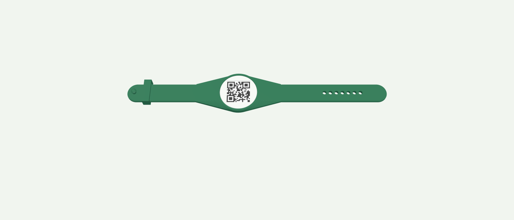
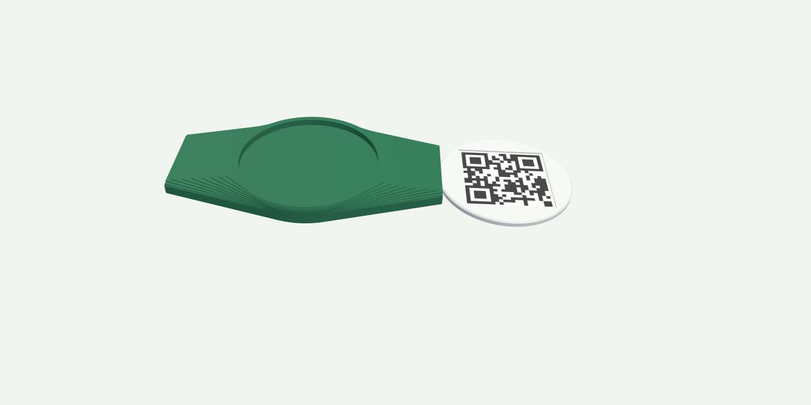

# Pulsera Safe.Ride v2 — tipo pulsera deportiva

Se imprime **plana** en **TPU flexible**. Al ponerla se curva sola alrededor de la muñeca.

| Archivo | Qué es |
|---|---|
| `pulsera_v2.stl` | Correa con el centro redondo, los 7 agujeros, el perno a presión y la trabita |
| `tapa_v2.stl` | Tapa al ras: va arriba de la etiqueta NFC y lleva pegado el QR |
| `prueba_centro.stl` | Solo el centro (60 mm), para probar tamaño, encastre y lectura antes de imprimir todo |
| `gen_pulsera_v2.py` | Arma los tres STL. Cambiás las medidas de arriba y lo volvés a correr (`pip install manifold3d numpy`) |

## Medidas

- **Muñeca de referencia:** 16,5 cm en el agujero del medio. Los 7 agujeros van cada 5 mm, así que la pulsera sirve para muñecas de **15 a 18 cm**.
- **Correa:** 16 mm de ancho y 2,6 mm de espesor, con los bordes redondeados.
- **Centro:** redondo de 35 mm y bajo, de 4,4 mm de alto en total. La correa se va ensanchando y subiendo de a poco hasta el centro, así que se ve como una sola pieza.
- **Alojamiento del NFC:** 31,2 mm de diámetro. Deja 0,6 mm libres alrededor de la etiqueta de 30 mm, que entra sin doblarse. Tiene 1,5 mm de profundidad: 0,3 mm para la etiqueta y 1,2 mm para la tapa.
- **Tapa:** 31 mm de diámetro y 1,2 mm de espesor. Entra a presión y queda al ras. Arriba tiene un hueco de 20,4 × 20,4 mm y 0,3 mm de profundidad, para el QR de 20 × 20 mm con su margen blanco.
- **Cierre:** un perno a presión de 3 mm con cabeza de 4,4 mm en una punta. La cabeza pasa estirando el TPU y queda trabada. La trabita sostiene la punta que sobra.
- **Largo total:** 216 mm. Si la cama de tu impresora mide 220 × 220 mm, poné la pulsera **en diagonal**.

## Cómo imprimir

1. **Primero la prueba:** imprimí `prueba_centro.stl` y `tapa_v2.stl`.
   - Apoyá el centro en la muñeca.
   - Fijate que la tapa entre al ras.
   - Probá el NFC con el celular, apoyando la etiqueta suelta debajo de la tapa, antes de pegarla.
2. **Pulsera:** TPU 95A, capas de 0,2 mm, 3 perímetros, relleno del 20 al 30 %, sin soportes.
   - La trabita es un puente corto de unos 20 mm y sale sin soportes.
3. **Tapa:** en TPU, o en PLA o PETG blanco si la querés más rígida y plana para el QR.
4. **Armado:** pegá la etiqueta NFC en el fondo del alojamiento, pegá el QR en la tapa y encastrá la tapa a presión.
   - Si queda floja, una gota de pegamento flexible en el borde alcanza.

## Para tener en cuenta

- La cara que toca la piel es **plana, con los bordes redondeados**, porque la pulsera se imprime acostada. Una curva por debajo necesitaría soportes. Como el TPU es flexible, igual se adapta a la muñeca.
- Las medidas del perno y de los agujeros conviene confirmarlas con la prueba. Si el perno entra muy duro, subí `AGUJERO_DIAM` a 3,4. Si se sale, bajalo a 3,0.
